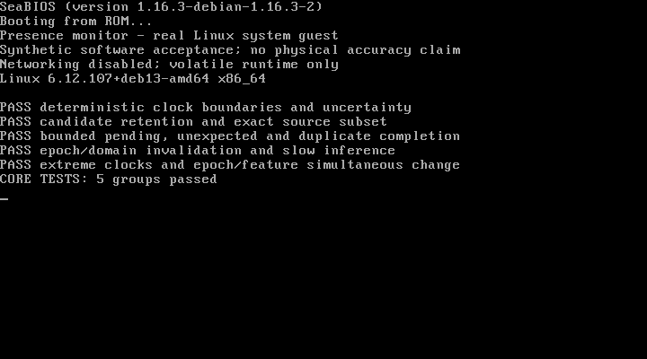
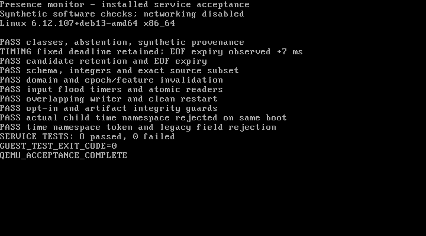

# Cooperative Wi-Fi Presence Monitor

**Linux software means** · C++17 · version 0.1.0

Publish a current zone-level `present`, `absent` or `unknown` estimate from
supplied normalized Wi-Fi features, with separate evidence validity, declared
domain eligibility, capture age and provenance. Missing or expired evidence
never means absence.

The implementation includes a portable core, strict local NDJSON decoder,
frozen linear inference adapter, bounded Linux worker/timer loop and atomic
local JSON publication. It provides no radio acquisition, trained physical
presence model or claim of real-world detection accuracy. Included fixture
recipes are explicitly synthetic and require `--allow-synthetic`.

## Build and run

```sh
cmake -S . -B build -DCMAKE_BUILD_TYPE=Release
cmake --build build --parallel
ctest --test-dir build --output-on-failure
cmake --install build --prefix /usr/local
wifi-presence-monitor --config /etc/wifi-presence-monitor/config.json
```

See [build/install instructions](docs/building.md) for dependencies, unprivileged
staging, core-only and sanitizer/static builds, service-account setup and the
optional systemd unit. The operator supplies the input FIFO, frozen reviewed
bundle/profile and trusted manifest hash. No model or site configuration is
installed by default.

## Current scope

One process serves one configured zone. It reads one local stream, assembles
bounded exact-source windows, qualifies them, executes one frozen model and
writes one atomic current-result file. Configuration changes require restart.
One worker and at most one pending candidate keep inference backlog bounded;
input processing cannot own the expiry loop. Consumers verify the local clock
domain and original deadline independently at every use.

A later bad candidate or node dropout cannot renew or by itself erase an
independently eligible earlier estimate. Known relevant invalidation, accepted
abstention and expiry withdraw the class. Candidate diagnostics and optional
last-known history remain distinct from current evidence in the same record.

## Architecture gallery

Click a diagram for its full-size SVG. Each view links to its editable PlantUML
source; the [diagram catalogue](docs/diagrams/README.md) includes deployment,
data objects, startup and recovery views.

<table>
  <tr>
    <td width="50%" align="center" valign="top">
      <strong>Users and use cases</strong><br>
      <a href="docs/diagrams/use_cases.svg"></a><br>
      <a href="docs/diagrams/use_cases.puml">PlantUML source</a> · <a href="docs/use-cases.md">Use cases</a>
    </td>
    <td width="50%" align="center" valign="top">
      <strong>Clean Architecture dependencies</strong><br>
      <a href="docs/diagrams/dependencies.svg"></a><br>
      <a href="docs/diagrams/dependencies.puml">PlantUML source</a> · <a href="docs/architecture.md">Architecture</a>
    </td>
  </tr>
  <tr>
    <td colspan="2" align="center">
      <strong>Runtime pipeline</strong><br>
      <a href="docs/diagrams/components.svg"></a><br>
      <a href="docs/diagrams/components.puml">PlantUML source</a> · <a href="docs/implementation.md">Implementation</a>
    </td>
  </tr>
  <tr>
    <td colspan="2" align="center">
      <strong>Current-result lifecycle</strong><br>
      <a href="docs/diagrams/result_state.svg"></a><br>
      <a href="docs/diagrams/result_state.puml">PlantUML source</a> · <a href="docs/lifecycle.md">Lifecycle</a>
    </td>
  </tr>
</table>

## Verification and evidence

[Software acceptance evidence](docs/testing/README.md) documents native tests,
sanitizers, clean installation and actual QEMU Linux system guests. The QEMU
harness boots the installed service with a volatile root filesystem, synthetic
inputs and no network device; genuine VGA console captures and derived results
are retained with exact artifact hashes. These are software checks, not physical
sensing studies. Linux x86-64 is tested; OpenWrt and prplOS qualification is future
work.

<table>
  <tr>
    <td width="50%" align="center" valign="top">
      <strong>QEMU: core checks — 5 groups passed</strong><br>
      <a href="docs/testing/qemu-core.png"></a>
    </td>
    <td width="50%" align="center" valign="top">
      <strong>QEMU: installed service — 8 groups passed</strong><br>
      <a href="docs/testing/qemu-service.png"></a>
    </td>
  </tr>
</table>

Click either genuine console capture for full resolution. The
[checked-run report](docs/testing/software-acceptance-2026-10-13.md) and
[numerical receipt](docs/testing/software-acceptance-2026-10-13.json) record the
synthetic inputs, observed timings, checks and artifact hashes.

## Documentation

- [Architecture, patterns and dependency direction](docs/architecture.md)
- [Implemented pipeline and its scope](docs/implementation.md)
- [Versioned configuration/model/input/result contracts](docs/interfaces.md)
- [Data ownership](docs/data-model.md) and [result lifecycle](docs/lifecycle.md)
- [Five observation-support failure causes](docs/lifecycle.md#five-causes-of-lost-observational-support)
- [Editable PlantUML and SVG diagrams](docs/diagrams/README.md)
- [Installation/privacy](docs/installation.md) and [platform boundary](docs/platforms.md)
- [Acceptance requirements](docs/verification.md) and [use cases](docs/use-cases.md)

The core depends on standard C++ values and pure rules. JSON, OpenSSL, Linux I/O
and threading stay outside it. Runtime state is volatile; there is no telemetry,
persistent cache, source discovery, remote/context/health API or radio control.
Outputs concern a zone, not identity or exact position. Person counting, fall
detection, medical interpretation and SOS are separate prospective capabilities.
Dependency license notices are retained in the installed package.
