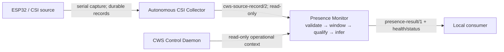

# Architecture

## System boundary

The monitor is a consumer and publisher. It reads collector-owned source
records and optional CWS operational context, evaluates a frozen sensing model,
and emits a versioned result. It has no ownership of acquisition, experimental
records, feature-training data, or controller state. It must have no command
path to the collector actuator or an access point.

Finalized collector run files are authoritative for replay and reconciliation.
Its live UDP mirror is best-effort; loss, duplication, reordering, or reconnect
discontinuity can make the current result `unknown`. A live adapter may read
that feed but must not claim complete delivery or create a competing capture
format. New IPC requires a versioned contract and collector-side review.

CWS context is optional. Current paths expose host network and read-only
prplOS/TR-181 context. The monitor reads but never writes their state/history
files. A future adapter normalizes documented fields into a versioned view.
Missing, stale, or malformed context is `unknown`; it does not invalidate fresh
sensing evidence unless the frozen profile explicitly requires that field.

## Components

1. **Input adapters** parse the collector's versioned record envelope and the
   optional CWS context. They preserve source identity, record ordering,
   timestamps, parser status, and integrity facts. They are read-only.
2. **Window assembler** builds the configured observation window per source.
   It detects missing sequences, duplicates, late records, reconnects, boot or
   configuration changes, and stale evidence. It does not repair or fabricate
   source timestamps.
3. **Evidence qualifier** emits a reason-coded state for data integrity,
   temporal support, compatible feature coverage, and domain eligibility.
   Each category is separate so a downstream reader can distinguish “no
   positive estimate” from “not enough evidence to estimate.”
4. **Portable inference core** applies a frozen feature transformation and
   hash-verified model to qualified windows. It may combine nodes only when the
   frozen model manifest explicitly supports that source subset and the
   windows have a defensible shared time basis.
5. **Result publisher** atomically publishes the current result and a bounded
   append-only status history. It exposes current `unknown` independently from
   the last-known historical result. It does not store raw CSI in its result
   history.
6. **Platform adapters** own file/IPC/socket access, service lifecycle, and
   logging. They cannot change model semantics or turn invalid evidence into a
   valid class.

The portable core should be deterministic for a fixed input window, model
bundle, and configuration. Configuration, model, and pipeline hashes are
included with every result. A model or pipeline reload is an explicit state
transition: the service first publishes `unknown` while it validates the new
bundle, then starts a new evidence window under that bundle. It must not join
windows scored by incompatible model versions.

## Presence and validity are distinct outputs

The classifier's state is a three-valued estimate: `present`, `absent`, or
`unknown`. The evidence-validity state is separately `valid`, `invalid`, or
`unknown`; domain eligibility is `eligible`, `ineligible`, or `unknown`.
`present` and `absent` are permitted only when evidence is valid, the configured
domain checks pass, and the artifact declares a compatible feature/source
combination. Otherwise the current estimate is `unknown`, accompanied by all
applicable reason codes.

This is a monitoring output, not a person count, identity, exact position,
medical measurement, security alarm, or proof of occupancy. “Absent” means only
that the frozen model returned its negative class for the stated zone and
evidence window. It does not prove that nobody is there. A particular
application must decide what action, if any, follows a result; that action is
outside this mean.

## Authority and failure behavior

The collector owns records and firmware command transactions. CWS owns its
measurement policy and its assessment of timing validity. The presence monitor
may apply stricter validity requirements for its model but may not weaken or
rewrite CWS/collector facts. It never requests a new sample rate to recover
confidence. If a result is unknown, the publisher records why and waits for
new, qualified evidence or a reviewed model/configuration change.

Restart, broken input, clock discontinuity, model-hash mismatch, unsupported
schema, adapter failure, or incompatible model/pipeline state leads to
`unknown` until state is re-established. Last-known data remains historical
with its original window and expiry; it is never copied into the current field.
