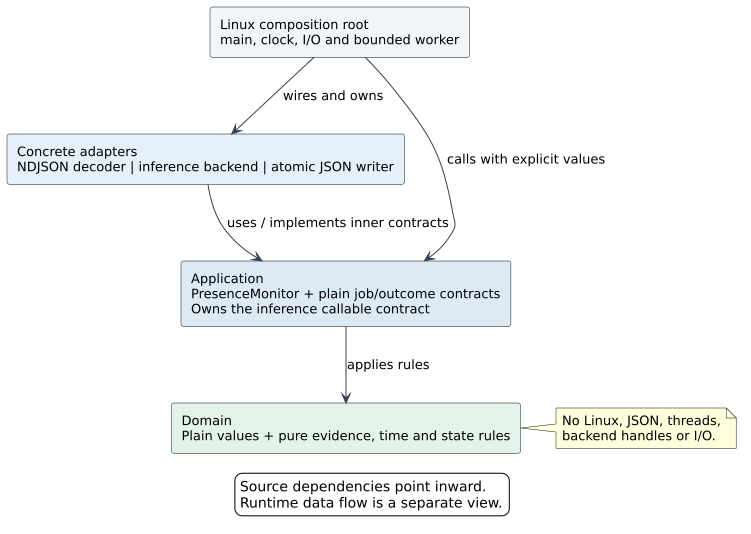
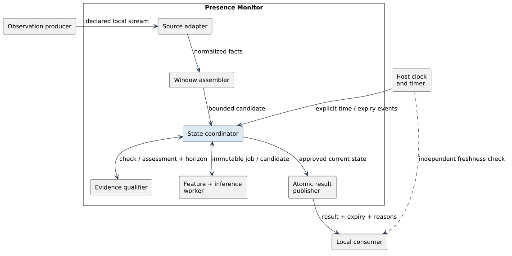

# Architecture

The proposed means has one task: publish a justified current zone-level
presence estimate from supplied Wi-Fi observations. It owns neither
acquisition, model training, radio control nor measurement policy. All
components below are planned.

## Dependency rule



Arrows in this view are source dependencies, not runtime message flow.

| Boundary | Owns | May depend on |
|---|---|---|
| Domain | Plain observation/window/model-contract/result values; pure integrity, compatibility, domain, age and result-transition rules | C++17 standard value/container facilities only |
| Application | One concrete `PresenceMonitor` coordinator; bounded assembly, current/candidate/history ownership, admission, job IDs and generation checks | Domain |
| Adapters | Declared NDJSON decoder, reviewed inference implementation, JSON encoder/atomic file writer | Application contracts and domain values; their selected external libraries |
| Linux composition root | Startup validation, concrete wiring, local pipe, clock/timer, bounded worker and process lifecycle | Application and adapters; Linux/runtime libraries |

No inner header exposes JSON-library, file-descriptor, thread, platform or
model backend types. A parsed model contract is a plain value; a loaded
backend/model handle belongs to the inference adapter. Feature extraction code
and model execution stay together behind that adapter and must match the frozen
contract. Domain rules do not call a clock or perform I/O. The runner passes
explicit time and normalized facts and executes plain jobs/results returned by
the coordinator.

There is one replaceable behavior boundary: the application-defined inference
callable, `InferenceJob -> InferenceOutcome`. The worker invokes the supplied
implementation; the coordinator never waits for or calls the backend directly.
The outcome distinguishes a model class, abstention and execution failure. This
is a contract, not a requirement for a virtual class hierarchy. Constructor
injection or a typed callable is sufficient; choose the simplest binding when
an actual backend is selected. There is no interface for every domain value,
assembler, qualifier, publisher, clock or platform.

## Processing responsibilities



This second view describes runtime flow. Its boxes are responsibilities, not
separate services or mandatory polymorphic classes.

| Responsibility | Boundary and role |
|---|---|
| Decode source | Concrete adapter validates the one declared wire schema and preserves source facts; no metadata guessing |
| Assemble window | Application holds bounded records; domain rules reject mixed epochs, unsupported gaps or invented source subsets |
| Qualify evidence | Pure domain rules separate validity, declared domain eligibility, compatibility and conservative capture age |
| Coordinate state | One concrete application object serializes transitions; decides which job/result may leave the core |
| Execute inference | One host-managed worker calls the reviewed adapter on an immutable qualified job; it cannot publish |
| Publish | Concrete outer writer encodes an approved result and atomically replaces one file; it cannot change decision semantics |
| Run service | Linux runner owns clock, local I/O, scheduling and resource cleanup; it does not interpret outages as absence |

The decoder is the input integration seam, not a runtime adapter registry. The
initial implementation supports exactly one frozen normalized input encoding.
Another source format requires a separately implemented and tested adapter.

## Event and execution model

The host loop calls concrete coordinator operations for normalized
observations, explicit time, known relevant invalidations and inference
completions. These are ordinary typed calls, not a generic event bus, observer
framework or command hierarchy. The coordinator returns plain actions: submit
an immutable job and/or publish a result. They need no callbacks into
infrastructure.

The runner owns one running worker job and one completion slot. The coordinator
owns at most one latest pending eligible window. Together these bound inference
backlog; the pending window is requalified before dispatch. Replacing a pending
window records a whole-window skip; it does not remove samples from a retained
window. Job/window IDs bind each completion to its submitted immutable input. A
generation token advances on a known relevant invalidation and clears pending
incompatible work, so a late result cannot restore invalidated state. A later
rejected candidate alone is not such an invalidation.

Only the loop thread mutates coordinator state. The worker has one bounded
completion handoff and cannot update current state. Window/payload storage has
explicit ownership through completion; no borrowed view may outlive its buffer.
A running backend is not assumed cancellable. A hung worker can prevent new
inference, but the timer and independent consumer expiry still withdraw old
results. No hard real-time guarantee is claimed.

The Linux runner uses nonblocking input and bounded work per loop iteration so
an always-readable stream cannot starve timer/completion processing. Expiry and
known invalidation are handled before admitting more input. Publication is one
bounded record on a configured volatile local filesystem; the consumer remains
the expiry backstop if any host operation stalls. Shutdown withdraws current
state when possible and releases owned resources. A stuck backend may require
process termination by the service manager; no unsafe thread cancellation or
unbounded shutdown guarantee is assumed.

Frame size, source count, window/payload memory, bundle size and diagnostic
size are configured limits checked against the reviewed bundle. No unbounded
replay, automatic source discovery, implicit subset fallback or traffic
increase is planned. Capacity loss is explicit.

## Candidate and current result

A new candidate awaits admission. A current result is a previously accepted
estimate still eligible under its own original window and deadline. Rejecting a
candidate cannot refresh or invalidate that older result by itself. Relevant
known changes, accepted abstention and expiry withdraw its categorical class.
Optional history never supplies the current class.

One result file includes current state, a bounded and separately labelled
candidate-diagnostics section, and optional last-known history. This avoids a
second health endpoint while keeping their scientific meanings separate. See
[lifecycle rules](lifecycle.md).

## Model and configuration lifecycle

The integrator selects one reviewed bundle and profile at startup. The bundle
binds artifact hashes, exact features, presence-class semantics, supported
source subsets, time requirements and declared operating envelope. Hashes
verify identity, not scientific correctness; motion-only negatives cannot
become `absent`.

There is no hot-reload method, management socket or runtime model selection.
Changing model/configuration uses a controlled stop/start. After establishing a
writable output path, startup replaces any old output with `unknown`, creates a
new opaque runtime session, validates configuration, loads and verifies the
bundle, and only then admits new evidence. A validation failure leaves unknown
with explicit reasons; no automatic rollback or model search. An unwritable
output path fails startup; a consumer then applies its independent expiry rule
to any surviving old file. The service manager must ensure the old process has
exited before starting another writer. Old process jobs/history are not
restored. In-process generations remain necessary for evidence invalidation,
independently of this startup lifecycle. The [restart
sequence](diagrams/configuration_startup.svg) shows this boundary.

## Patterns kept and complexity avoided

| Technique | Concrete reason | Minimal form |
|---|---|---|
| Adapter | Separate wire/backend representation from domain meaning | Concrete decoder, inference adapter and writer |
| Strategy | Replace the selected model backend without changing admission/expiry rules | One injected inference callable; no plugin loader or registry |
| Explicit state machine | Make `present`, `absent`, `unknown`, expiry and invalidation auditable | Values and transition functions; no State subclass per class |
| Composition root and dependency injection | Keep platform choices at startup and test the use case independently | One `main` wires concrete objects; no DI container or abstract factory |
| Bounded producer/consumer worker | Keep model computation off the expiry loop | One worker, one pending job, one completion slot; no broker/actor system |
| RAII | Release model, memory, file and thread resources on normal paths and errors | Standard owned objects; no general resource framework |

An abstract repository, database layer, microservices, network API, generic
scheduler and configurable processing graph solve no current requirement and
are excluded. Extensibility means replacing an outer integration or adding a
justified use case later; it does not mean prebuilding extension interfaces.

## Proposed source layout

This is a future layout, not source scaffolding created by this design:

```text
src/domain/        # values and pure policy functions
src/application/   # concrete coordinator and plain job/outcome contracts
src/adapters/      # NDJSON, selected inference backend, JSON/file publication
app/main.cpp       # Linux runner and composition root
```

One portable core library contains domain/application code; one Linux
executable links it and the adapters. These directories express responsibility,
not a requirement for four libraries or packages. Coordinator tests pass
explicit time and deterministic completion values; runner tests can inject a
deterministic inference callable. No clock/filesystem mock interface is needed
for domain/application tests.

## Current scope and extension conditions

| First version | Add only when required and qualified |
|---|---|
| One configured zone, local NDJSON input, one local JSON result | Additional source encoding or multiple zones |
| One frozen startup bundle/profile | Runtime reconfiguration with its own safety/state contract |
| Supplied observation metadata and declared domain gates | Operational-context integration or an actual drift detector |
| Same-host verified clock domain | Remote transport and bounded clock/delivery semantics |
| Linux process with no persistent cache | OpenWrt/prplOS packaging and permission/interface qualification |

None of the future column has a placeholder interface in the first version. The
means does not count people, track identities, detect falls or send SOS.
