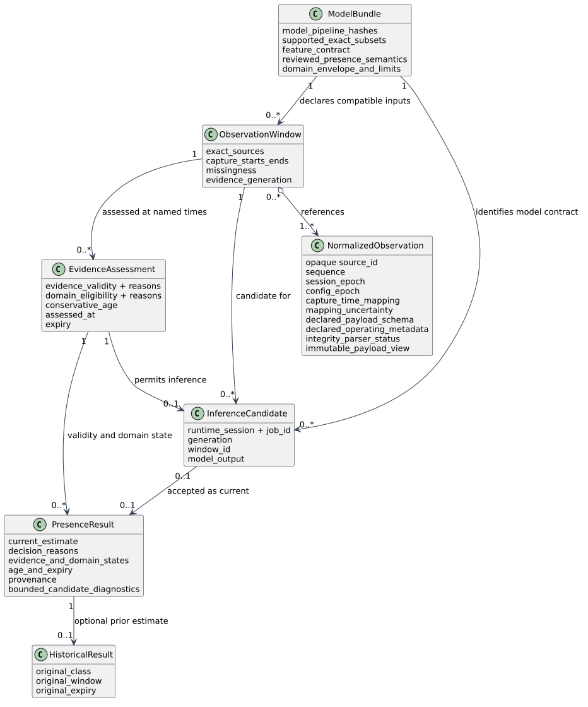

# Data and ownership model

This is a planned data contract for a read-only, zone-level presence estimate.
It specifies concepts and relationships; it does not define an executable API
or a frozen JSON schema. The proposed serialized result name is
`wifi-presence-result/1`. The means consumes normalized records and publishes
current state with unpublished model output and historical context kept
distinct.

## Records and ownership

- **NormalizedObservation** is an adapter-produced view of one source record.
  Its source ID is opaque. It preserves sequence, session and configuration
  epochs, capture time and any mapping uncertainty, plus the declared payload
  schema, required declared operating metadata, integrity/parser status and an
  immutable payload view whose lifetime
  is owned by the domain value. The original source remains authoritative for
  its facts; the adapter preserves them, and the monitor must not fabricate
  missing facts. Domain records contain portable values, not JSON, OS or
  backend-specific types.
- **ObservationWindow** is an assembled, bounded set of exact source records.
  It identifies included sources, capture starts and ends in their declared
  time basis, sequence gaps and other missingness, and the evidence generation
  under which it was assembled. It does not imply complete delivery where the
  source cannot guarantee it.
- **ModelBundle** identifies the model and pipeline by hashes, the exact
  supported source subsets and feature contract, and reviewed class semantics
  for the presence task, including stationary people. It declares a domain
  envelope and limits to be supported by the model review. They do not
  guarantee that every environmental change can be observed.
- **EvidenceAssessment** carries evidence validity and domain eligibility as
  independent states, each with reasons. It also records conservative age and
  expiry at a named assessment time when these can be established. A qualifier
  checks declared conditions only; it cannot detect every unobserved
  environmental change.
- **InferenceCandidate** is an unpublished model output tied to one window and
  evidence generation and immutable model contract. It is not itself the published current result.
- **PresenceResult** is the current published estimate with `decision_reasons`,
  evidence and domain states, age, expiry, and provenance. The proposed
  `decision_reasons` specifically records model abstention or decision failure;
  evidence-validity reasons remain separate.
- **HistoricalResult** preserves an earlier result's original class, window,
  and expiry. It is never substituted for the current estimate.

The model's `absent` class is not proof that nobody is present. The output does
not provide person count or identity and does not detect falls or issue SOS
alerts.

## Decision and time behavior

For each included source `i`, let `e_i` be its mapped capture-window end and
`epsilon_i` the nonnegative mapping uncertainty. Conservative evidence age is
`A = max_i(now - e_i + epsilon_i)` in a shared declared time basis. Evidence is
fresh only while `A <= A_max`, where `A_max` comes from the declared bundle or
profile; this design sets no numeric thresholds. Missing mappings, unbounded
uncertainty, incompatible time bases, or unsupported cooperative subsets
prevent that inference. The result retains the source window and provenance so
that a consumer can interpret the estimate and its validity horizon.

A serialized application coordinator owns state transitions and returns plain
inference jobs and accepted results to an outer runner; it does not call a
publisher or clock interface. A startup-selected model and profile remain
static for the process lifetime. Changes use a controlled stop/start, not hot
reload. Within a run, the coordinator permits one running and at most one
pending immutable inference job, while timer processing remains responsive.
Each job and candidate carries a unique runtime/session token, generation and
window ID; completion from an obsolete token or generation is discarded.
Advance the in-process generation only for a relevant known invalidation. A
failed, gapped, or dropped candidate may leave the previous valid estimate
current only until that estimate's original expiry. Known incompatibility or
domain invalidation withdraws it immediately and publishes `unknown`. A
model/profile change requires controlled stop/start, which begins unknown under
a fresh runtime/session token. By default, at most one prior estimate is
retained separately in memory as `last_known`, represented by HistoricalResult
with its original class, window, and expiry. Candidate rejection diagnostics
are kept in one bounded diagnostics section of the same result record; they are
separate from current evidence reasons and do not create a second endpoint or
file.

Current state, candidate diagnostics, and history have separate roles: only the
current PresenceResult answers the current query; candidates expose unpublished
model outputs; historical records preserve prior outcomes without extending
their validity.
