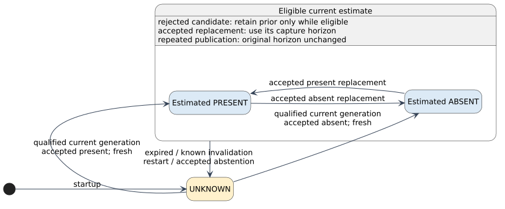
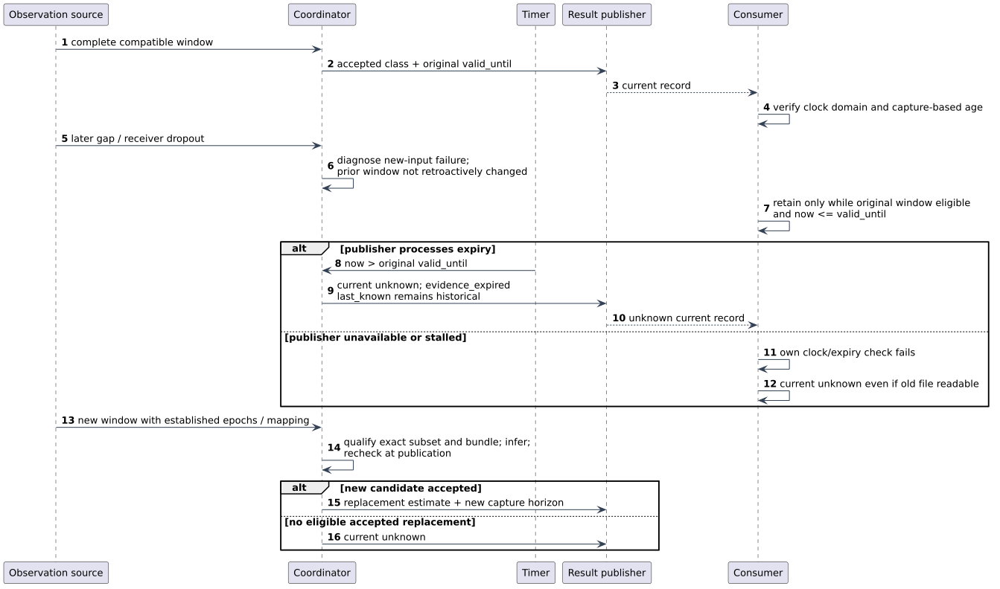

# Result lifecycle and failure decisions

These are planned decision rules. They constrain how a reviewed presence model
may be used; they do not establish that such a model has been trained or validated.

## Current, candidate, diagnostic and historical state

The current result is `present`, `absent` or `unknown`. A categorical result
requires valid evidence, eligible declared conditions, a supported exact
feature/source/model combination, a permitted model output and unexpired
capture-based age. Model abstention can yield `unknown` even with valid evidence
and eligible conditions; `decision_reasons` records that separately.

A candidate window is assessed independently of the current result. Failure of a
new candidate does not retroactively invalidate an older complete window. The
older result may remain current only while its original conditions and deadline
still hold. Candidate rejection is a health diagnostic; it is not represented by
changing the current result's evidence assessment to invalid while retaining its
categorical class.

Historical `last_known` retains its original class, window and expiry. It may be
shown as history after current state becomes unknown, but never used as the
current estimate. The default history is at most one in-memory historical result.
Restart begins unknown without automatically restoring prior history.

## Transition decisions

| Event | Current-result decision | Candidate/acquisition consequence |
|---|---|---|
| Startup, no reviewed bundle or required facts unknown | Unknown | Wait for valid configuration and observations; do not supply a default class |
| New complete compatible window, accepted current-generation model output | Replace with its estimated class after publication-time recheck | Record its capture window, fixed deadline and provenance |
| Model abstains on an otherwise eligible new window | Publish unknown with `model_abstained` | Do not fall back to an earlier categorical estimate |
| New candidate has gaps, bad records, late input or an unsupported reduced subset | Keep prior estimate only if independently eligible; otherwise unknown | Reject candidate and expose all applicable diagnostic reasons; original deadline unchanged |
| Receiver disappears after an eligible complete window | Retain only to that window's original deadline if no applicability invalidation is known | New reduced-input inference requires an independently supported subset |
| Known feature/configuration/domain change invalidates current interpretation | Withdraw immediately; unknown | Advance affected generation and rebuild compatible windows |
| No replacement before age exceeds the fixed maximum | Unknown with `evidence_expired` | Keep last-known history; wait for eligible replacement |
| Reload/restart, or a clock discontinuity invalidating the current mapping | Unknown for affected state | Reject incompatible old windows/completions; establish new state |
| Optional context missing or stale | Preserve sensing result unless a declared required gate is invalidated | Report context status separately |
| Publisher fails or stops updating | Consumer independently withdraws class when its own validity test fails | Never treat a readable old file as fresh evidence |

A transport pause or end-of-stream after a valid window is a no-new-data event.
It does not renew or automatically erase that window. A source declaration that
proves a relevant epoch or configuration changed is an invalidation event, not a
mere transport pause. A source-only reboot or clock reset always breaks new
window assembly across that boundary; it withdraws an old estimate only when
its retained mapping or applicability is invalidated. No inference of absence
follows from these events.

## Acceptance order

1. Preserve source facts and assemble one bounded, generation-specific window.
2. Qualify integrity, required metadata, exact subset/features, declared domain
   conditions and time alignment. Unsupported/unresolved requirements prevent
   submission to the inference worker.
3. Execute the frozen pipeline/model on an immutable job.
4. On completion, reject an old generation; re-evaluate known invalidations and
   capture-time freshness at the actual publication time.
5. Publish an accepted class or model abstention atomically. A failed candidate
   may leave an independently eligible current result unchanged; it never
   changes that result's evidence clock.
6. Process timer events without depending on new records; the consumer enforces
   its own deadline too.

All applicable reasons remain visible; one failure does not conceal another.
There is no universal gap tolerance, subset model, environment-change detector,
expiry threshold or safety criterion in this design.

## Time boundary

[The interface contract](interfaces.md#time-and-expiry-contract) defines
`A = max_i(now - e_i + epsilon_i)` and
`valid_until = min_i(e_i - epsilon_i + A_max)` for a common declared time basis.
The existing boundary is inclusive: `A <= A_max` is eligible; `A > A_max` is
expired. The local timer withdraws at the first representable tick beyond the
deadline. Clock precision and uncertainty must already be included in the
reviewed bounds; a coarse timer does not justify displaying a class beyond its
validity. Consumers evaluate freshness at their own use time.

This is a necessary age condition, not proof that a fresh estimate is correct.
No receipt timestamp, inference completion, restart or repeated publication may
reset capture age. Unknown or unbounded mappings permit no categorical validity
horizon on that route.

## Interrupted input and recovery

Recovery requires new eligible evidence under a supported bundle. Restoring
packet delivery alone does not repair incompatible features or a changed room.
A returning node must establish its epoch and time mapping before cooperative
use. A separately reviewed subset model may provide a replacement, but subset
selection or missing-feature zero filling is not performed automatically.
