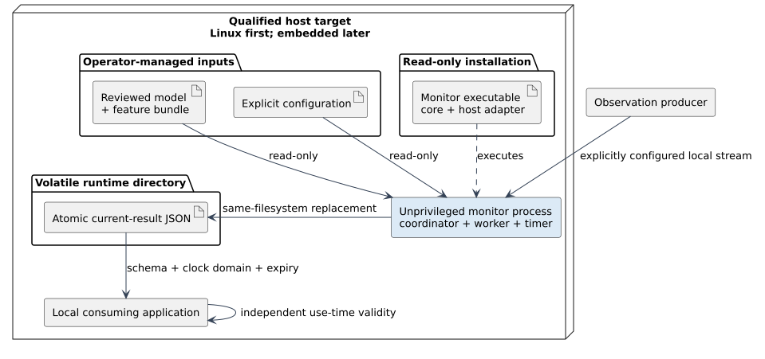

# Platforms and deployment boundary

## Portable core

The proposed C++17 domain/application core owns normalized values, bounded
window assembly, eligibility/freshness policies and result-state decisions.
Feature/model execution is supplied through one application-defined inference
contract; JSON serialization belongs to a concrete outer adapter. The core
receives typed values from adapters. It does not own radio acquisition, device
discovery, wireless drivers, platform control APIs, or network policy.

A future build must name supported architectures, compilers, libraries and
runtime dependencies. C++17 alone does not define ABI or guarantee that a
target supplies those dependencies. No source code, binary, package, or
supported toolchain is provided by this design.

## Linux service adapter

Linux is the proposed first service target, subject to a named and tested
support matrix. The adapter may manage service lifecycle, local input access,
result publication and bounded diagnostics. Paths, permissions and service user
are deployment configuration, not compiled defaults. The initial transport is
one declared local NDJSON pipe and one atomic local JSON file; it is not a
configurable transport framework. The process should run with least privilege
and read-only access to observation sources. A build for one Linux target does
not establish support for other architectures or distributions.

## Optional embedded adapters

OpenWrt is a possible later target requiring a selected SDK, target ABI,
dependency verification, package metadata, service definition, and device
testing. `procd` and `ubus` provide service and IPC mechanisms; they do not
provide CSI or normalized observations. Integration must remain read-only and
must not write configuration or alter radio, association, routing, QoS, or
measurement policy.

prplOS or another managed access-point stack is a possible platform adapter
only when a specific image, SDK, permission model, and stable observation
interface have been verified. A stack-specific sensing interface is not a
universal CSI interface. No AP, firmware, vendor, or sensing API compatibility
is claimed.

## Deployment claims

“Portable” describes a core boundary and design intent. Installability and
support apply only after clean builds, packaging, and operation have been
verified for named targets. A platform adapter cannot compensate for missing or
unsuitable sensing data. Software conformance does not establish detection
accuracy, transfer to another environment, privacy acceptability, or safety.

## Planned host deployment

The first process consists of one Linux runner, the portable coordinator and
domain rules, one inference worker and a concrete atomic file writer. The
runner wires dependencies at startup; no platform base class or plugin
framework is required. The clock/timer and local stream/file I/O belong to the
host adapter. The coordinator remains responsive to timer and invalidation
events while a worker computes. This is a planned execution boundary, not
measured timing behavior.

A producer supplies an explicitly configured local stream. The reviewed model,
profile and feature pipeline are read-only runtime inputs outside the package's
compiled defaults. One current-result file contains current state, separate
bounded candidate diagnostics and optional history in an operator-configured
volatile directory. Model/configuration changes use restart. A suspend-aware
`CLOCK_BOOTTIME` timer runs independently of input and inference. Consumers
independently check the result's named clock domain and expiry. There is no
network listener, remote discovery, cloud service or automatic control
connection in this pilot.

OpenWrt service/IPC and prplOS integration must preserve the same semantics. An
AP-hosted deployment may need a separate source adapter; a standard service
manager or IPC library does not create a CSI feed. Exact architecture, image,
SDK, inference-backend dependencies and permissions must be recorded and tested
before that platform is listed as supported.
