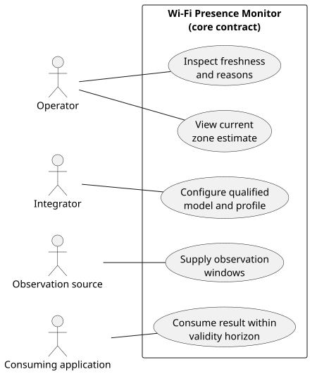
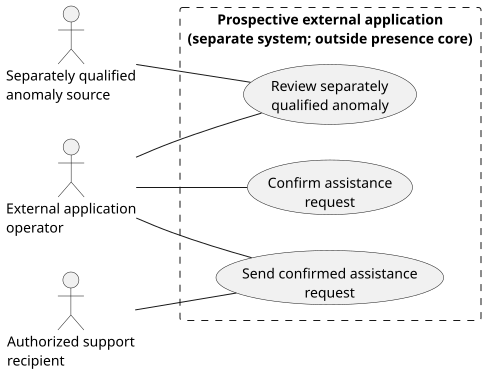

# Actors and use cases

The diagram summarizes goals at the software boundary. The core monitor is
implemented; operator/application goals use its one local result record. No
built-in UI is shipped. The separate assistance diagram remains prospective.

The source supplies normalized records through one configured local stream; the
monitor assembles windows while preserving timestamps, integrity and
missingness. The integrator configures a model and profile that have been
qualified for the declared input and operating envelope. Changes require a
controlled restart. The operator and consumer use the same local result record;
no built-in UI, control API or separate health service is shipped. The operator
views the current zone-level `present`, `absent`, or `unknown` estimate and may
inspect its freshness and reasons. A consuming application consumes the
versioned result within its stated validity horizon; when the horizon expires
or a required gate fails, the current result is `unknown`.

The second diagram shows a separate, prospective application. Its dashed
boundary distinguishes it from the presence monitor. It can review an anomaly
only when a separate source has qualified that anomaly. In a future
application, an operator may confirm an assistance request for that application
to send to an authorized recipient. Neither anomaly qualification nor request
handling belongs to the presence-core contract. The core does not track
individuals, count people, diagnose medical events, detect falls, or issue SOS
messages. The diagram does not claim that the application or source exists or
has been validated.

See the [local rendering instructions](diagrams/README.md#render-locally) for
syntax checking and source-metadata-free SVG generation.
